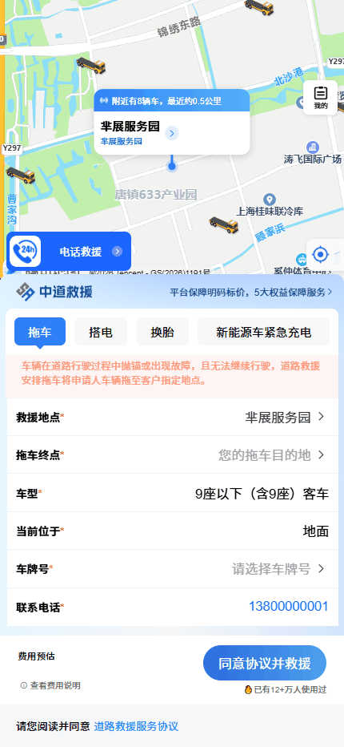
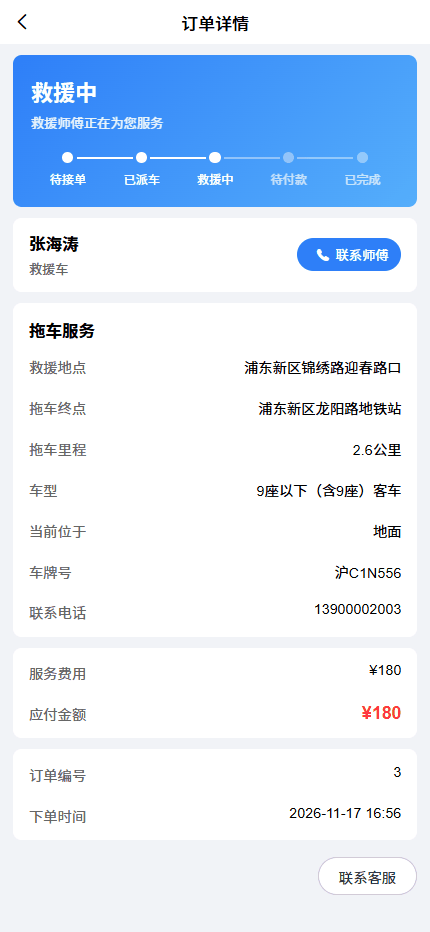
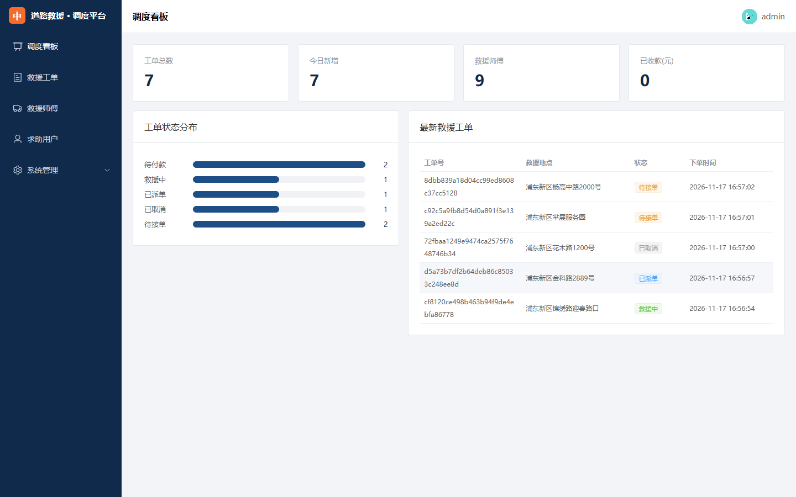
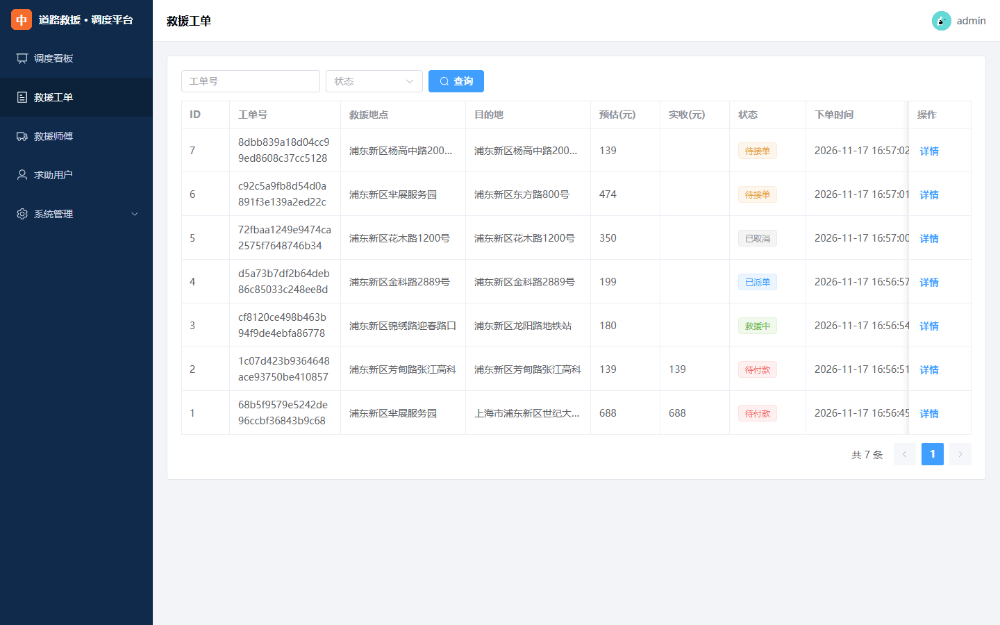
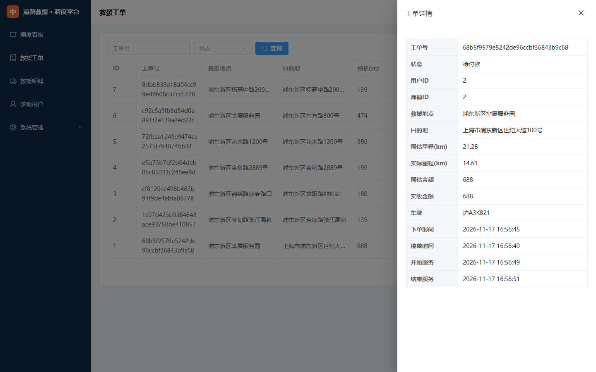

# 道路救援 (Road Rescue)

车主在手机上一键呼叫拖车、搭电、换胎、紧急充电，附近的救援师傅抢单上门，调度人员在 PC 端掌握全部工单。乘客端 + 救援司机端（uni-app）+ 调度管理端（Vue 3），后端基于乐尚代驾 Spring Cloud 微服务改造。

[](./LICENSE)


## 界面预览

**乘客端 / 司机端（H5）**

<table>
  <tr>
    <td></td>
    <td></td>
    <td></td>
  </tr>
  <tr align="center"><td>乘客首页：附近板车与下单</td><td>乘客端：救援进度</td><td>司机端：抢单大厅</td></tr>
</table>

**调度管理端**

<table>
  <tr>
    <td></td>
    <td></td>
    <td></td>
  </tr>
  <tr align="center"><td>调度看板</td><td>救援工单</td><td>工单详情</td></tr>
</table>

## 功能特性

- **呼叫救援**：选择救援地点和拖车终点，填写车型、车牌，提交拖车、搭电、换胎、紧急充电订单。
- **附近板车**：乘客首页地图显示附近在线的救援车辆和最近距离。
- **自动派单**：新订单按距离推送给附近符合接单条件的师傅。
- **抢单与服务**：师傅在大厅抢单，一单只归一人；之后到达、验车、开始救援、结束救援，全程记录轨迹。
- **计费结算**：服务结束后由服务端按规则计费并生成分账，H5 支持支付宝沙箱支付。
- **订单查询**：乘客查看进行中和历史订单，可取消尚未被接的单。
- **调度管理**：看板统计、工单详情、师傅审核、乘客启停、系统用户/角色/菜单权限。

## 快速开始

需要 JDK 17、Maven 3.9、Node.js 18+ 和 Docker Desktop。在仓库根目录用 PowerShell 执行：

```powershell
# 1. 构建定制版 XXL-JOB 调度中心（Compose 会挂载这个 jar）
cd backend/xxl-job-master; mvn -pl xxl-job-admin -am -DskipTests package; cd ../..

# 2. 中间件：MySQL、Redis、RabbitMQ、MongoDB、Nacos、XXL-JOB（首次启动自动建库）
docker compose -f backend/infra/docker-compose.yml up -d

# 3. 密钥模板与 Nacos 配置
copy backend\.env.example backend\.env      # 填入腾讯地图 key 等
powershell backend/scripts/nacos-import.ps1

# 4. 演示数据（司机认证、接单设置、当日人脸记录）
docker cp backend/sql/test-data.sql roadrescue-mysql:/tmp/test-data.sql
docker exec roadrescue-mysql sh -c 'mysql -uroot -p"$MYSQL_ROOT_PASSWORD" < /tmp/test-data.sql'

# 5. 编译并启动全部后端服务
cd backend/daijia-parent; mvn -DskipTests install; cd ../..
powershell backend/scripts/start-all.ps1 -JdkHome <你的 JDK 17 目录>

# 6. 三个前端，各开一个终端
cd apps/admin-web; npm i; npm run dev
cd apps/passenger-uniapp; npm i; npm run dev:h5
cd apps/driver-uniapp; npm i; npm run dev:h5
```

uni-app 默认 `VITE_API_MODE=mock`，不需要后端也能看界面；在各自的 `.env` 里设为 `real` 才接真实后端。

| 服务 | 地址 | 账号 |
| --- | --- | --- |
| 管理端 | http://localhost:9527 | `admin` / `111111` |
| 乘客端 H5 | http://localhost:9090 | 登录页点「演示账号」，验证码 `123456` |
| 司机端 H5 | http://localhost:9091 | 登录页点「演示账号」，验证码 `123456` |
| XXL-JOB | http://localhost:8080/xxl-job-admin | 确认派单任务已启动 |
| 网关 | http://127.0.0.1:8600 | 接口入口 |

停止用 `backend/scripts/stop-all.ps1`。逐步说明、端口表、常见问题见 [操作手册](docs/操作手册.md)。

## 技术栈

| 模块 | 技术 |
| --- | --- |
| 后端 | Java 17、Spring Boot 3.0.5、Spring Cloud 2022.0.2、Spring Cloud Alibaba（Nacos）、OpenFeign、MyBatis-Plus |
| 业务组件 | XXL-JOB 派单、Redisson 分布式锁、Drools 计费规则、RabbitMQ 消息 |
| 数据与存储 | MySQL 8、Redis 7（登录态、GEO、派单队列）、MongoDB 6（服务轨迹） |
| 管理端 | Vue 3、Vite 5、Element Plus、Pinia |
| 乘客端 / 司机端 | uni-app（Vue 3）、Pinia、Sass，H5 运行 |

## 项目结构

```text
RoadRescue/
├─ backend/
│  ├─ daijia-parent/    # Spring Cloud 微服务：网关、web-customer/driver/mgr、service-*；DEFAULT_GROUP 为 Nacos 配置
│  ├─ infra/            # docker-compose 中间件
│  ├─ scripts/          # start-all / stop-all / nacos-import / smoke-test
│  ├─ sql/              # daijia.sql、tables_xxl_job.sql、test-data.sql、migrations
│  ├─ xxl-job-master/   # 定制版 XXL-JOB 调度中心源码
│  └─ .env.example      # 微信、腾讯云密钥模板（复制为 .env，已 gitignore）
├─ apps/
│  ├─ admin-web/        # 调度管理端，端口 9527
│  ├─ passenger-uniapp/ # 乘客端，H5 端口 9090
│  └─ driver-uniapp/    # 司机端，H5 端口 9091
├─ docs/                # 操作手册、开发说明、支付配置、截图
└─ evidence/            # 早期关键页截图
```

## 文档导航

| 分类 | 文档 |
| --- | --- |
| 使用与部署 | [操作手册](docs/操作手册.md)：本地启动、三端操作、派单抢单、常见问题 |
| 开发 | [开发说明](docs/开发说明.md)：接口对照、后端改动、已知缺口 |
| 支付 | [支付宝沙箱支付](docs/alipay-sandbox.md) |

## License

本项目使用 [MIT License](./LICENSE)。
