# 道路救援操作手册

适用对象：第一次接触本项目、不了解前后端和微服务的读者。本文命令以 Windows PowerShell 为例，项目位置为 `D:\Projects\IDEAProjects\RoadRescue`。

验证日期：2026 年 11 月 1 日。本手册先核对 README、配置、启动脚本和业务代码，再使用 **agent-browser CLI** 实际登录、下单、抢单、开始和结束服务。截图均为本次浏览器实拍，保存在项目的 `docs/image/`，没有使用历史 `evidence/` 截图替代。本次没有修改业务代码。

**本次结果：真实订单 7 已完成“下单 → 自动派单 → 抢单 → 到达 → 验车 → 开始 → 两点轨迹入库 → 结束计费”，后端状态为 6，账单 19 元、分账记录已生成。真实道路轨迹、微信支付和钱包入账没有验收。** 页面价格和状态存在差异，详见第 8、9 章。

## 1. 项目是什么

道路救援是道路救援全栈演示项目，基于乐尚代驾后端改造。用户可以申请拖车、搭电、换胎、紧急充电；救援师傅通过司机端接单；调度人员通过管理端查看订单、师傅、用户和权限。

它包含三套界面和一套后端：

| 部分 | 技术 | 谁来使用、负责什么 |
| --- | --- | --- |
| 后端 | Java 17、Spring Boot、Spring Cloud 微服务 | 保存订单、维护登录、搜索附近司机、抢单、计费、分账、保存轨迹 |
| 管理端 | Vue 3 + Vite + Element Plus + Pinia | 调度与管理员查看看板、工单详情、师傅审核、用户状态、系统权限 |
| 乘客端 | uni-app、Vue 3、Pinia | 申请救援、查询进行中与历史订单、查看师傅信息 |
| 司机端 | uni-app、Vue 3、Pinia | 演示登录、查看接单大厅、抢单、发车、送达、查看我的订单 |

“前端”就是浏览器里的界面；“后端”是处理数据的程序；“中间件”是数据库、缓存、任务调度等支撑程序。“H5”在这里指浏览器打开的移动端网页，不需要安装手机 App。“微服务”是把后端拆成多个各司其职的 Java 程序。

请求大致按下面的顺序传递：

```text
乘客页面 → /customer-api → 网关 8600 → web-customer → service-order 等业务服务
司机页面 → /driver-api   → 网关 8600 → web-driver   → 司机、订单、地图等服务
管理页面 → /mgr-api      → 网关 8600 → web-mgr      → 订单、司机、乘客、系统服务
新订单 → service-dispatch → XXL-JOB → 搜索附近司机 → Redis 临时队列 → 司机大厅
服务结束 → MongoDB 轨迹 → Drools 计费和分账 → MySQL 账单
```

这是演示作品，不能把所有页面能力当成已经接入真实后端。尤其是价格、付款文案和钱包显示，应结合第 9 章理解。

## 2. 目录结构与阅读顺序

```text
RoadRescue/
├─ README.md                       项目概览
├─ docs/                           使用手册、支付配置与其他资料
│  ├─ 操作手册.md                  本手册
│  └─ image/                       本次实拍截图
├─ apps/
│  ├─ admin-web/                    管理端
│  │  └─ src/views/                 看板、订单、司机、乘客、系统管理页面
│  ├─ passenger-uniapp/             乘客端
│  └─ driver-uniapp/                司机端
│     （两个 uni-app 均有 pages/、api/、mock/、utils/、manifest.json）
├─ backend/
│  ├─ .env.example                 后端密钥模板；实际配置用 .env
│  ├─ daijia-parent/
│  │  ├─ pom.xml                   Maven 多模块工程入口
│  │  ├─ DEFAULT_GROUP/            要导入 Nacos 的 YAML 配置
│  │  ├─ server-gateway/           网关
│  │  ├─ web/                      web-customer、web-driver、web-mgr
│  │  ├─ service/                  service-order、driver、customer、map 等
│  │  ├─ service-client/           微服务互相调用用的 Feign 接口
│  │  ├─ common/                   通用工具、安全、日志、消息组件
│  │  └─ model/                    数据模型、状态枚举、请求与返回结构
│  ├─ infra/
│  │  ├─ docker-compose.yml        中间件编排
│  │  ├─ rabbitmq/                 延迟消息插件及启用配置
│  │  ├─ scripts/                 中间件启动、停止、验证脚本
│  │  └─ artifacts/                定制 XXL-JOB jar 的约定位置（当前缺失）
│  ├─ scripts/                     start-all、stop-all、nacos-import 等
│  └─ sql/                         业务库、XXL-JOB 表、演示数据
└─ evidence/agent-browser/         项目原有截图；不是本文本次验收依据
```

建议先读本文，再读根目录 README；需要排查接口时看 `apps/*/mock/real-adapter.js`。两个 uni-app 子目录里的 README 仍是 RuoYi 模板介绍，不是道路救援的实际操作说明。`backend/infra/README.md` 的部分旧路径也已过时，中间件以当前 Compose 文件为准。

## 3. 环境要求、地址与账号

### 3.1 软件准备

需要安装并启动 Docker Desktop（Linux 容器模式），安装 JDK 17、Maven 3.9、Node.js 18+ 和 npm。浏览器推荐使用可正常访问本机 localhost 的 Chromium 系浏览器。实际运行多套 Java 服务和 Docker 会占用较多内存，建议电脑至少 16GB 内存并给 Docker 留出资源；这属于使用建议，不是脚本硬性检查。

先打开 PowerShell，检查命令：

```powershell
Set-Location 'D:\Projects\IDEAProjects\RoadRescue'
java -version
mvn -v
node -v
npm -v
docker version
docker compose version
```

`mvn -v` 应显示使用 Java 17。本文不需要 Python。已经运行的服务不用重复启动，否则可能端口冲突。

### 3.2 浏览器入口

| 入口 | 地址 | 本地演示账号 |
| --- | --- | --- |
| 管理端 | http://localhost:9527 | `admin` / `111111` |
| 乘客 H5 | http://localhost:9090 | 打开自动演示登录，映射乘客 ID 1 |
| 司机 H5 | http://localhost:9091 | 点击“演示账号”填入 `13800138000`、`123456` 后登录 |
| XXL-JOB | http://localhost:8080/xxl-job-admin | `admin` / `123456` |
| Nacos | http://localhost:8848/nacos | 当前 Compose 关闭认证，直接进入控制台 |
| RabbitMQ 管理台 | http://localhost:15672 | `admin` / `admin123` |
| 网关 | http://127.0.0.1:8600 | 接口入口，不是业务首页；直接打开根路径不一定有页面 |

司机登录页上的手机号来自本地演示 UI。real 模式调用 `/driver/demoLogin`，实际绑定司机 ID 1，不是按输入手机号查找真实司机。演示数据中司机 ID 1 是 `TestDriver`，数据库手机号为 `13800000002`；乘客 ID 1 为 `LocalTestCustomer`，手机号为 `13800000001`。

演示登录要求 Nacos 的 `web-customer-dev.yaml`、`web-driver-dev.yaml` 中 `roadrescue.demo-login.enabled: true`。这是开发演示开关，不应在正式公开环境启用。

### 3.3 中间件与后端端口

| 程序 | 端口 / 数据 | 用途 |
| --- | --- | --- |
| MySQL 8 | 3306；`root` / `shangguigu@QY123` | 8 个 `daijia_*` 业务库以及 `xxl_job` |
| Redis 7 | 6379；当前无密码 | 登录状态、分布式锁、司机 GEO 位置、派单队列 |
| MongoDB 6 | 27017；当前无认证，库 `daijia` | 服务轨迹 `orderServiceLocation` |
| RabbitMQ 3.9 | 5672、15672 | 业务消息、延迟消息 |
| Nacos 2.3.0 | 8848、9848 | 配置与服务注册；9848 也必须可达 |
| XXL-JOB admin | 8080 | 调度中心 |
| service-dispatch 执行器 | 9999 | XXL-JOB 回调执行派单任务 |
| service-customer / driver / map / rules | 8501 / 8502 / 8503 / 8504 | 乘客、司机、地图、规则 |
| service-order / payment / dispatch | 8505 / 8506 / 8509 | 订单、支付、派单 |
| service-system / coupon / mq | 8510 / 8511 / 8282 | 系统、优惠券、消息 |
| web-customer / driver / mgr | 8601 / 8602 / 8603 | 三端业务接口聚合 |
| server-gateway | 8600 | 统一接口入口 |

以上密码来自本地 Compose，仅用于理解当前演示环境。当前 Compose **没有 MinIO 和 Seata 容器**，虽然 README 或部分配置中仍有相关条目；不要误以为它们已由 Compose 启动。

## 4. 本地启动：按顺序执行

本节用于从停止状态启动。服务已经可用时，直接跳到第 5 章。每段命令按说明执行；三个前端分别占用独立终端，不能在同一个已被开发服务器占用的终端继续输入下一套启动命令。

### 4.1 先检查 XXL-JOB 的额外文件

**当前仓库存在冷启动缺口。** Compose 要挂载 `backend/infra/artifacts/xxl-job-admin.jar`，但本次检查该目录不存在。后端调用的是定制接口 `/jobinfo/addAndStartJob`、`startJob` 等，不能直接假设官方同版本镜像能兼容；也不能把普通 XXL-JOB 源码编译出的 jar 当成已具备这些接口的定制版本。

本次运行中的容器实际挂载了：

```text
%TEMP%\roadrescue-start-20261101-132045\xxl-job-admin.jar
```

这是当前机器已有的临时启动资产，可能随临时目录清理而丢失。可只读查看当前容器实际挂载：

```powershell
docker inspect roadrescue-xxl-job-admin --format '{{json .Mounts}}'
Test-Path .\backend\infra\artifacts\xxl-job-admin.jar
```

如果准备按仓库原始 Compose 重建容器，必须先取得兼容本项目接口的定制 jar，放到上述约定位置。当前机器临时副本尚在时，可按以下方式准备（只在需要冷启动时执行）：

```powershell
$xxlJar = Join-Path $env:TEMP 'roadrescue-start-20261101-132045\xxl-job-admin.jar'
if (-not (Test-Path $xxlJar)) { throw '缺少定制 XXL-JOB jar，请先向项目维护者取得兼容版本' }
New-Item -ItemType Directory -Force .\backend\infra\artifacts | Out-Null
Copy-Item -LiteralPath $xxlJar -Destination .\backend\infra\artifacts\xxl-job-admin.jar
```

jar 不在 Git 中。换电脑只有仓库代码时，这一步不能凭空完成。本手册记录了缺口，没有修改 Compose 或替换业务代码来掩盖它。

### 4.2 启动中间件

从项目根目录执行：

```powershell
docker compose -f .\backend\infra\docker-compose.yml up -d
docker compose -f .\backend\infra\docker-compose.yml ps
powershell -NoProfile -ExecutionPolicy Bypass -File .\backend\infra\scripts\verify.ps1
```

等待六个容器均为 `Up`，有健康检查的服务显示 `healthy`。首次拉镜像和建库可能需要数分钟。首次空 MySQL 数据卷会自动执行 `backend/sql/daijia.sql` 和 `backend/sql/tables_xxl_job.sql`；已有数据卷不会重新执行。**不要为了解决普通启动失败运行 `down -v`，它会删除数据卷。**

RabbitMQ 需要仓库中的延迟消息插件 `.ez` 文件。Nacos 需要同时映射 8848 与 9848。XXL-JOB 不仅需要页面可打开，还要能从容器访问宿主机派单执行器 9999。

### 4.3 配置后端密钥并导入 Nacos

首次没有 `backend/.env` 时复制模板，已有文件不要覆盖：

```powershell
if (-not (Test-Path .\backend\.env)) {
    Copy-Item .\backend\.env.example .\backend\.env
}
notepad .\backend\.env
powershell -NoProfile -ExecutionPolicy Bypass -File .\backend\scripts\nacos-import.ps1
```

`.env` 按 `KEY=VALUE` 填写。H5 演示登录不依赖微信 appId，但真实地图算路需要有效的 `TENCENT_MAP_KEY`。OCR、人脸、COS、微信支付另需对应密钥；留空意味着这些外部能力不能据此验收。不要把实际密钥复制到手册或提交 Git。

导入脚本会把 `backend/daijia-parent/DEFAULT_GROUP/*.yaml` 逐个发布到 Nacos 的 `DEFAULT_GROUP`，成功返回 `true` 并回读配置长度。打开 Nacos“配置管理 → 配置列表”，在 public 命名空间确认 `common-account.yaml` 和各 `*-dev.yaml` 存在；“服务管理 → 服务列表”用于稍后检查后端注册。

注意：导入脚本上传 YAML，不会把 `.env` 文本替换进去。占位符由 Java 进程运行时环境解析。`start-all.ps1` 通过 `load-env.cmd` 加载 `backend/.env`，把 `APP_ID/APP_SECRET` 映射为 `WX_APP_ID/WX_APP_SECRET`。修改后端环境变量后应重启相关服务；重新导入 Nacos 会覆盖同名配置，先保留自己的配置差异。

### 4.4 导入演示数据

推荐使用 `backend/sql/test-data.sql`。它设置乘客 ID 1、司机 ID 1、认证通过、启用接单、接单距离以及当天的人脸记录，避免 H5 演示必须调用腾讯人脸接口。

PowerShell 不支持 README 示例中的 shell 输入重定向 `<`。使用以下命令，让容器内 shell 读取 SQL：

```powershell
docker cp .\backend\sql\test-data.sql roadrescue-mysql:/tmp/roadrescue-test-data.sql
docker exec roadrescue-mysql sh -c 'mysql -uroot -p"$MYSQL_ROOT_PASSWORD" < /tmp/roadrescue-test-data.sql'
```

SQL 的用户、司机和设置部分使用重复键更新；当天人脸记录是追加写入，不需要反复导入。换一天演示时检查当日人脸记录。演示司机设置为 `service_status=1`、`order_distance=0`（不限制订单里程）、`accept_distance=50`（公里）；但附近司机搜索的后端半径仍固定为 **5 公里**，并不会因为大厅显示 50/100KM 就自动扩大。

### 4.5 编译并启动后端

先确认 Maven 用的是 Java 17，再执行：

```powershell
Set-Location 'D:\Projects\IDEAProjects\RoadRescue\backend\daijia-parent'
mvn -DskipTests install
# 看到 BUILD SUCCESS 后再继续；上面的命令跳过了测试，不代表业务验收通过
Set-Location 'D:\Projects\IDEAProjects\RoadRescue'
powershell -NoProfile -ExecutionPolicy Bypass -File .\backend\scripts\start-all.ps1 -JdkHome 'D:\Develop\Java\jdk-17'
```

把 `-JdkHome` 改成自己电脑的 JDK 17 根目录（包含 `bin/java.exe` 的目录），脚本默认就是上面的路径。缺少 jar 会被提示，不能把“脚本结束”当成所有服务已启动。

脚本启动 14 个 Java 进程，按基础服务、业务服务、web 层、网关顺序拉起。等待约 60～90 秒，具体以 Nacos 实际注册健康情况为准。验收派单必须有 `service-dispatch`，不要使用 `-SkipDispatch`。局部重启可用 `-Only service-order,web-customer`，但先停止这些模块的原进程，避免重复占端口。

仓库原脚本默认写 `backend/logs/*.log` 和 `pids.csv`，Compose 默认还会把部分中间件日志写入 `backend/infra/data/`。本次手册制作复用了已运行环境，未执行这些默认启动脚本来新增项目日志；补启动管理端的输出放在 `%TEMP%\roadrescue-manual-20261101\`。

### 4.6 配置 H5 模式

分别检查 `apps/passenger-uniapp/.env` 和 `apps/driver-uniapp/.env`，没有文件时从各自的 `.env.example` 复制。真实联调设置：

```dotenv
VITE_API_MODE=real
VITE_GATEWAY=http://127.0.0.1:8600
TECENT_MAP_KEY=填写自己的前端腾讯地图Key
```

注意前端变量名是代码现有拼写 **`TECENT_MAP_KEY`**，后端则是 **`TENCENT_MAP_KEY`**，不能混用。H5 原生地图还涉及 `manifest.json` 中的地图 SDK 配置；地图无法使用时一并检查。

| 配置 | 含义 |
| --- | --- |
| `VITE_API_MODE=mock` 或未设置 | 默认本地模拟数据，可以看 UI，不能据此验收真实派单、锁、数据库和计费 |
| `VITE_API_MODE=real` | 登录和核心订单请求通过适配层访问后端；未覆盖能力仍回落本地 Mock |
| `VITE_GATEWAY` | Vite 开发代理的目标，默认 `http://127.0.0.1:8600` |
| `VITE_API_BASE` | 可选覆盖 API 基址；H5 默认分别 `/customer-api`、`/driver-api`，通常不用填写 |

修改 `.env` 后停止并重新启动对应 Vite 开发服务器，再刷新网页；不要以为修改文件立即等于当前浏览器已换模式。管理端不使用这套 Mock 切换，默认 `/mgr-api` 代理到网关。手机真机中的 `127.0.0.1` 指手机自己，不能直接照搬本机 H5 地址。

### 4.7 启动三个前端

打开三个独立 PowerShell 窗口，分别执行：

```powershell
# 窗口 A：管理端
Set-Location 'D:\Projects\IDEAProjects\RoadRescue\apps\admin-web'
npm install
npm run dev -- --port 9527 --strictPort
```

```powershell
# 窗口 B：乘客 H5
Set-Location 'D:\Projects\IDEAProjects\RoadRescue\apps\passenger-uniapp'
npm install
npm run dev:h5 -- --host 127.0.0.1 --port 9090 --strictPort
```

```powershell
# 窗口 C：司机 H5
Set-Location 'D:\Projects\IDEAProjects\RoadRescue\apps\driver-uniapp'
npm install
npm run dev:h5 -- --host 127.0.0.1 --port 9091 --strictPort
```

三端分别打开 9527、9090、9091。`--strictPort` 让端口冲突明确报错，避免自动换端口后误以为原地址可用。依赖已安装且未变化时可跳过 `npm install`。uni-app 的脚本已设置根目录为源码目录，不要自行改成不存在的 `src/`。

## 5. 管理端操作

### 5.1 登录与调度看板

打开 http://localhost:9527，填 `admin / 111111`，点“登录”。成功后进入“调度看板”。看板展示工单总数、今日新增、师傅数量、已收款统计、状态分布和最新工单。截图中的数字是拍摄当时数据库状态，不是固定目标值，也不能将历史已付款记录算成本次已支付。

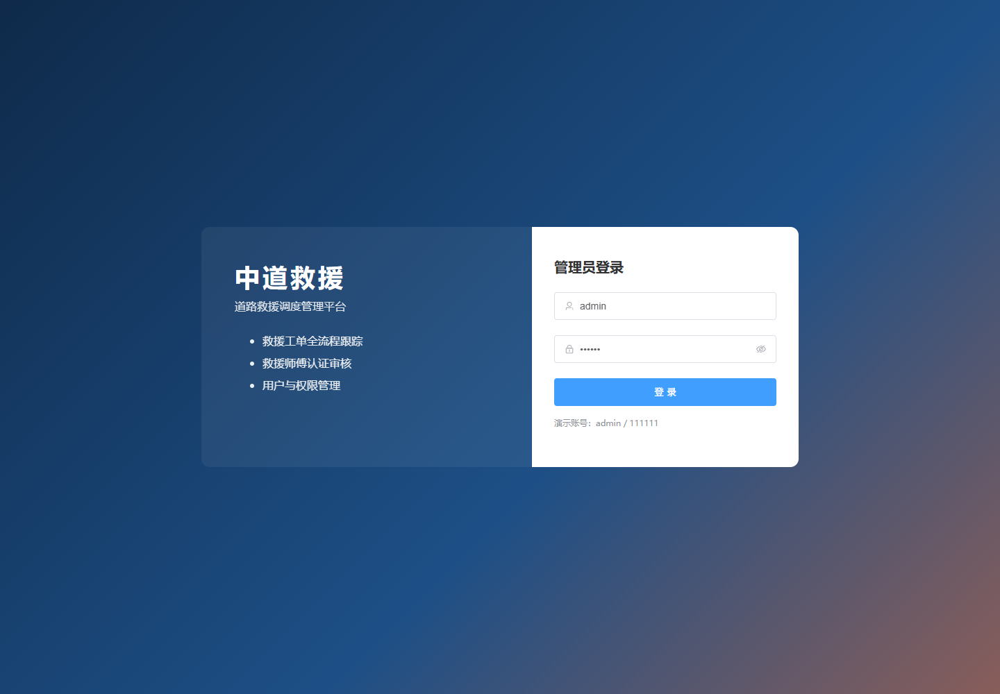

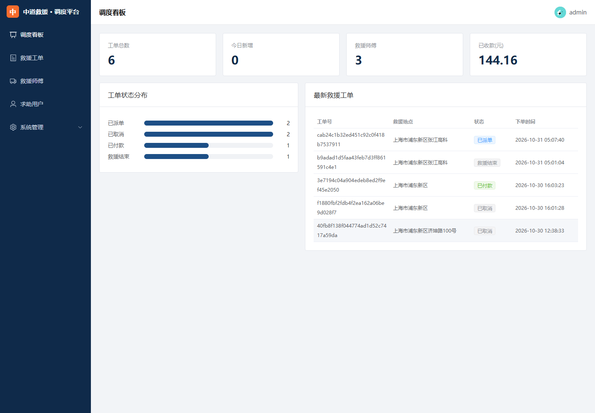

### 5.2 查看救援工单与详情

左侧点“救援工单”，可按工单号、状态查询，点每行“详情”打开右侧抽屉。工单号是长字符串；移动端“订单编号”显示的是数据库数字 ID，两者不是同一个字段。

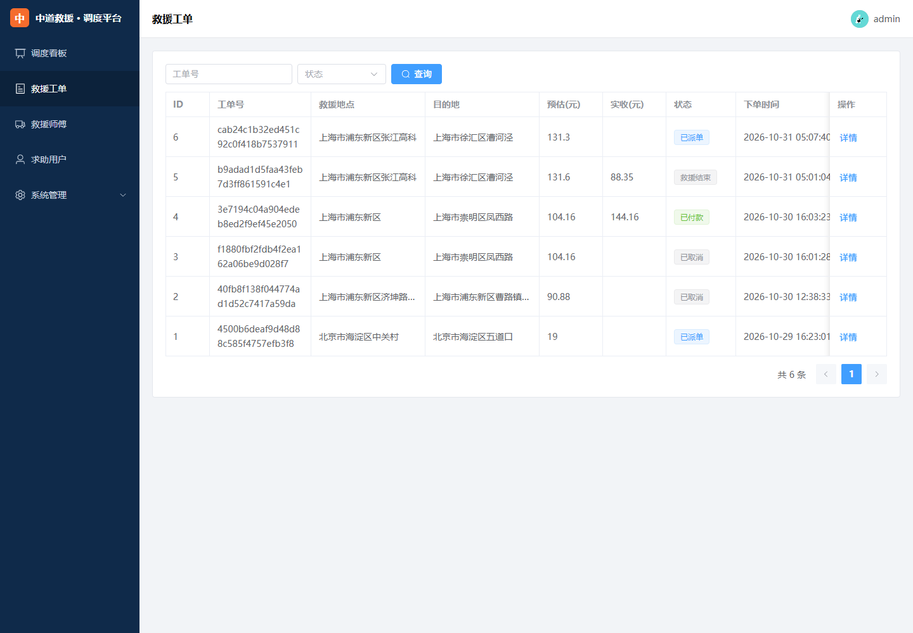

下图第一行是本次新建订单 7，完整工单号 `2d9a5056a1fa4a39b766bbf9937d3e06`。刷新列表使用“查询”，详情需要关掉再打开才能重新取最新数据。

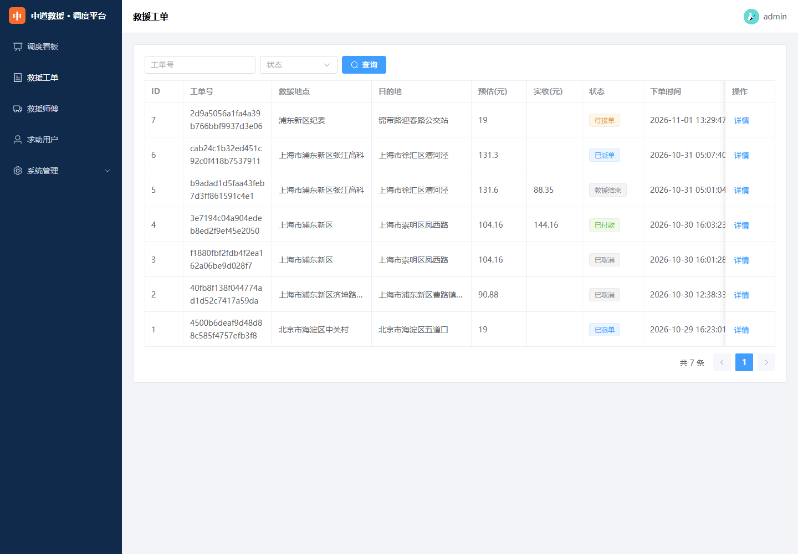

结算后的列表和详情见第 8 章。管理端菜单叫“调度平台”，但当前工单页面主要是查询，没有可直接点选司机改派的完整操作流程。

### 5.3 查看救援师傅

左侧点“救援师傅”，按姓名、手机号、昵称或认证状态查询。“详情”看资料，“通过/驳回”会修改认证状态。零基础验收只查看演示司机 ID 1 的“已认证”即可，不要随意修改其他人员数据。本次验证未操作审核变更。

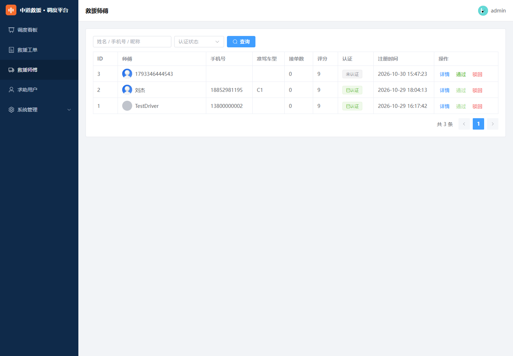

### 5.4 查看求助用户

左侧点“求助用户”，查询乘客资料。右侧状态开关控制启停；联调保持演示乘客 ID 1 启用。本次只查看列表，没有切换开关。系统管理还包含用户、角色和菜单，账号权限操作不属于本次救援链路验收。

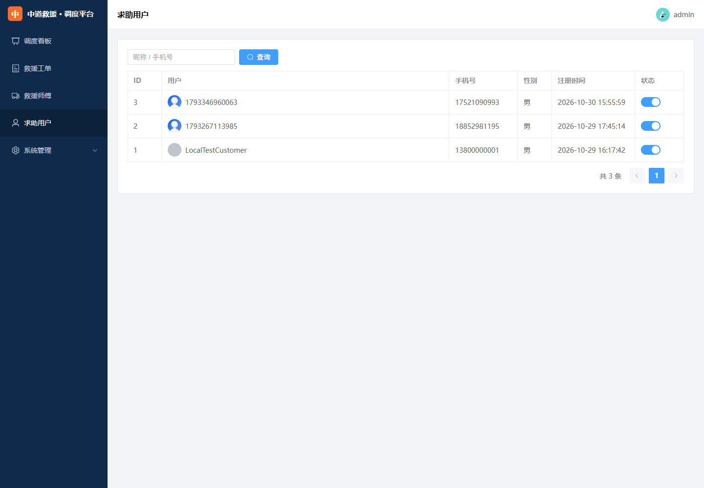

## 6. 乘客端操作：申请救援与查询订单

### 6.1 首页与位置

打开 http://localhost:9090，等待地图、地址和自动演示登录完成。首页提供拖车、搭电、换胎、新能源紧急充电。定位失败可能使用代码中的默认位置，不能把默认点当作自己真实位置。

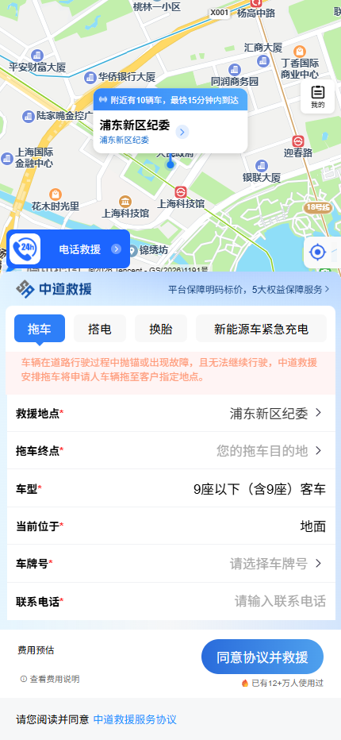

点“救援地点”选起点；拖车还必须点“拖车终点”。选择列表中的地点后，**再点选址页右上角对勾确认**，只点列表不会返回下单页。本次搜索“上海世纪公园”时结果区为空，后续取消搜索，改选实际返回的附近地点；没有伪造搜索成功。


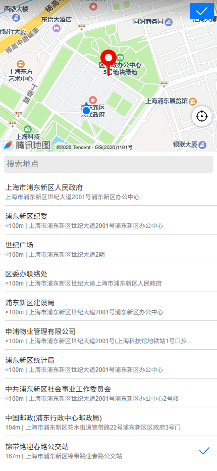

### 6.2 填写并提交订单

本次实测选择“拖车”，起点“浦东新区纪委”、终点“锦带路迎春路公交站”，导航预估 0.88 公里。保留默认车型和“地面”，点“车牌号”选择本地演示车辆 `沪AD12345`，联系电话填 `13800000001`。

车型、位置可点开选择；车牌页可以添加自己的演示车牌，不过车辆管理仍是本地 Mock。底部“查看费用说明”解释前端价格。确认服务协议和信息后，点“同意协议并救援”。不要连续重复点击创建多个订单。

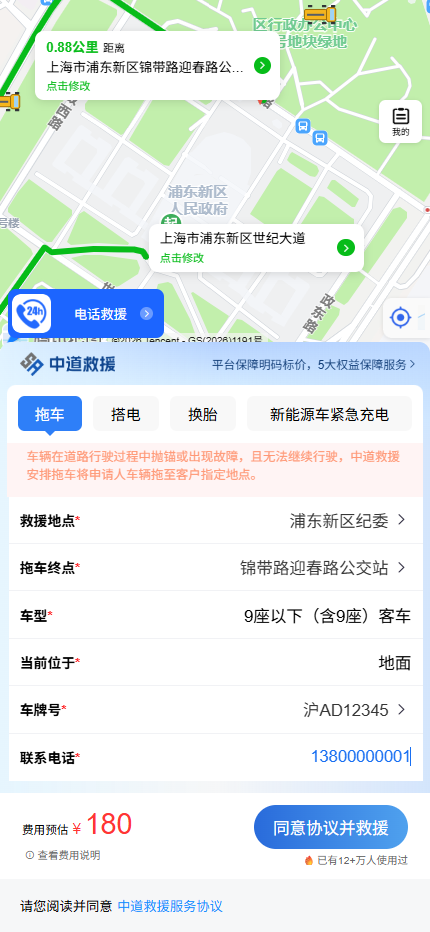

成功后自动打开详情，出现数字订单编号和“待接单”，本次编号为 7。记住自己的编号，后续只操作这张新单。截图不是把旧单改名后复用。

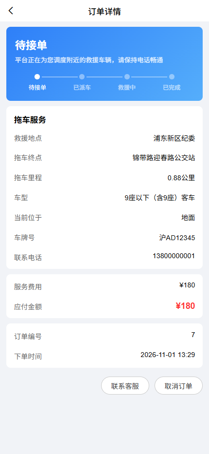

### 6.3 查询进行中和历史服务

首页右上“我的”实际进入“服务查询”，在“进行中服务/历史服务”间切换，点击订单卡片看详情。详情在进行中会约每 5 秒轮询；必要时返回列表重进。

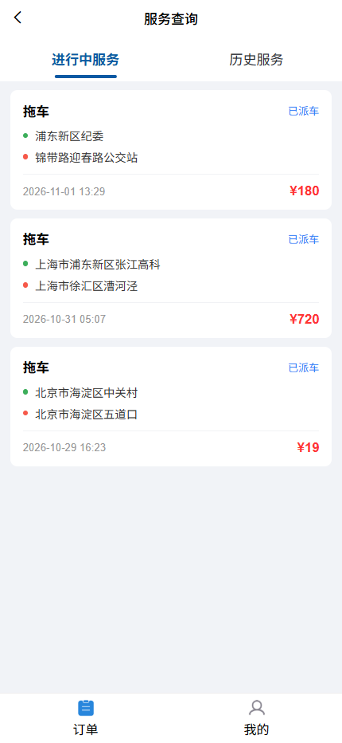

后端只允许待接单订单取消。界面在“已派车”时也可能保留取消按钮，点击后不代表一定可以取消；已接单需联系调度。最终历史订单与完成详情见第 8 章。

## 7. 司机端与 XXL-JOB：派单、抢单、开始服务

### 7.1 演示登录、准备接单

打开 http://localhost:9091，点登录卡片底部“演示账号……（点击填入）”，它会填手机号、验证码并勾选协议，再点蓝色“登录”。这里不是在验证真实短信服务。登录后进入“抢单大厅”。


联调前应完成第 4.4 节演示数据准备。司机登录后会在大厅上报位置；本次位置在上海浦东、接近订单起点。不要用相距很远的起点测试附近派单。H5 没有完整真实人脸与接单开关流程，演示数据直接设置了接单状态。

### 7.2 确认派单任务启动

打开 XXL-JOB，用 `admin / 123456` 登录，左侧点“任务管理”。选择“示例执行器”，寻找**与本次订单编号对应**的“新创建订单任务调度：7”，运行模式应为 `BEAN：newOrderTaskHandler`。

初始历史任务均为 STOP，并不说明新单不能派发；本次下单后自动生成了任务 ID 8，状态 **RUNNING**。如果自己的新单任务是 STOP，点该行“操作”右边下拉箭头 →“启动”，按页面提示确认。不要启动所有历史任务，也不要把 `demoJobHandler` 测试任务当成派单任务。

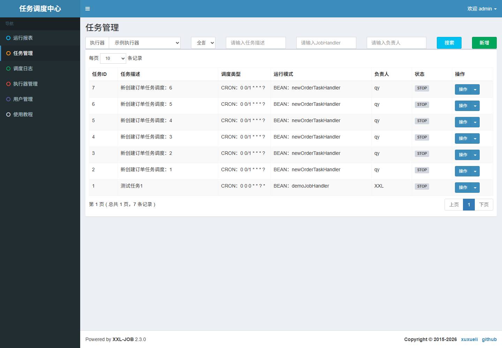


代码中的 CRON 是 `0 0/1 * * * ?`，按分钟调度。需要检查时可在正确任务的操作菜单点“执行一次”，打开弹窗后保存；这不代替后续保持任务启动。本次曾打开此弹窗，但取消了，没有手动触发派单，实际使用了自动调度。

“执行器管理”应有可达的注册节点。尤其是 XXL-JOB 在 Docker 内、执行器在 Windows 宿主机时，节点地址不能是容器自己的 localhost。检查容器可访问的宿主机地址和防火墙 9999 端口，实际地址随电脑网络变化，不要照抄截图内旧 IP。

### 7.3 收到派单与抢单

回司机大厅点击右下刷新按钮，等待请求结束。本次大厅出现“浦东新区纪委 → 锦带路迎春路公交站”，点该卡片“抢单”，成功后自动进入详情，状态为“待发车”。后端抢单使用 Redisson 锁。

**看到目标单后及时抢单。** 当前后端临时队列约 1 分钟过期，读取时会把消息取走；又有约 15 分钟的重复推送标记。频繁刷新或拖延会出现“刚才有单，刷新后没了”，不能据此判定订单已被别人抢走。大厅也不是持久展示全部待接单订单的查询页。


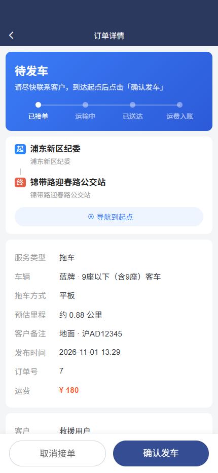

截图中大厅 19 元、详情 180 元的差异是真实问题。派单消息没有携带救援 `remark` 信息，详情重新查询后才有救援服务、车牌和价格；不要按大厅显示直接承诺结算价。

### 7.4 到达、验车、开始：合并在“确认发车”内

真实作业应先联系客户、到达起点并检查车辆。当前 H5 没有三个独立操作页，详情点“确认发车”会顺序执行：

| 顺序 | 适配层真实请求（均经 `/driver-api`） | 本次证据 |
| --- | --- | --- |
| 1 | `POST /location/updateOrderLocationToCache` | 把订单起点写入司机订单位置缓存，属于演示处理 |
| 2 | `GET /order/driverArriveStartLocation/7` | 到达接口成功；数据库 `arrive_time` 有值 |
| 3 | `POST /order/updateOrderCart` | 写入车牌和车型，车辆前后照片传空字符串 |
| 4 | `POST /order/startDrive` | 状态变为 5；数据库有开始时间，司机显示“运输中” |

本次 agent-browser 网络记录中四个请求均返回 HTTP 200，且后续状态、车牌、时间均已只读核对。**没有独立的到达/验车页面截图，不能把这一步说成现场定位或真实拍照验车已通过。** 到达校验要求位置接近起点，适配层直接缓存起点使演示能继续。

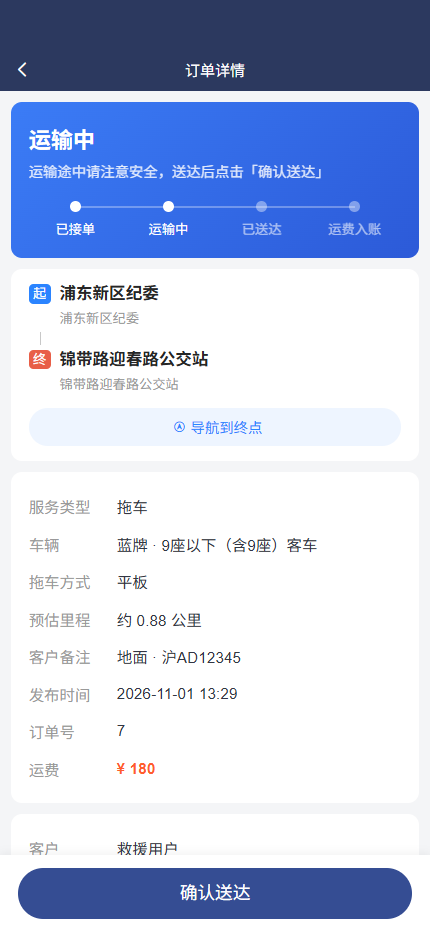

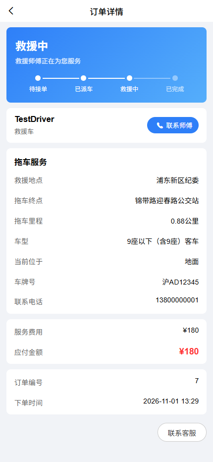

## 8. 轨迹、结束计费与本次验收结果

### 8.1 结束操作

司机订单处于“运输中”后点“确认送达”。适配层先调用 `POST /location/saveOrderServiceLocation`，补报起点、终点两个轨迹点，再调用 `POST /order/endDrive`；路桥、停车、其他费用本次均为 0。返回成功后司机详情显示“运费审核中”，不再显示送达操作按钮。

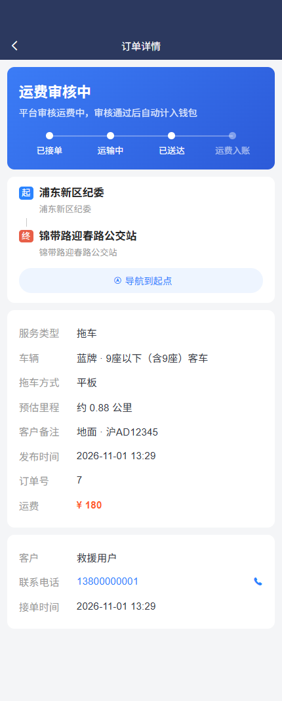

点左上返回大厅，再点底部“我的订单”。可按全部、待发车、运输中、已完成查看列表，点“订单号：7”可重新打开详情。


乘客回“服务查询 → 历史服务”可见订单 7，详情显示“已完成”。但其“实付金额 180 元”是当前页面映射结果，**不是微信付款成功凭证**。


### 8.2 管理端回查结算

管理端“救援工单 → 查询”，找到订单 7，点“详情”。本次展示“救援结束”、预估金额 19、实际里程 0.17 公里、实收金额 19，以及接单、开始、结束时间。**这里的“实收金额”绑定后端 `realAmount`，在状态 6 仍不能理解为已收款。**

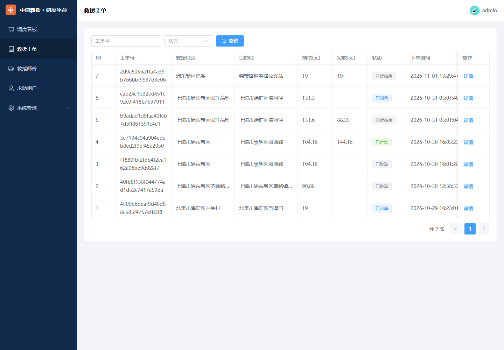

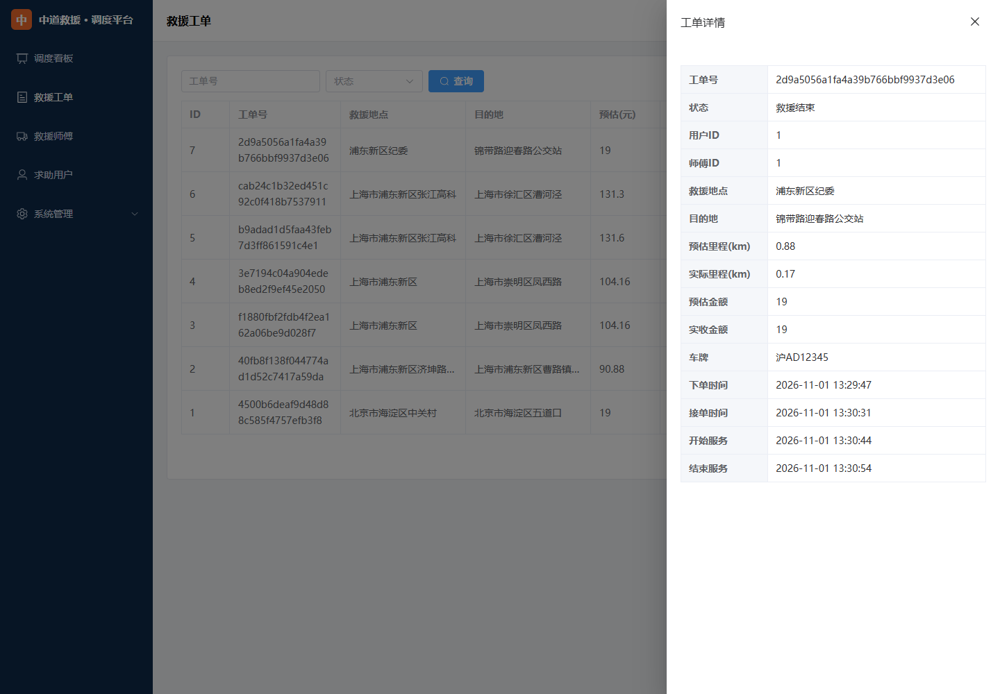

XXL-JOB 检查到订单不再等待接单时会自动停止该任务。本次任务 8 已变 STOP，调度与执行结果均显示成功。新单需要 RUNNING，而已接单或结束单的任务 STOP 属正常现象。


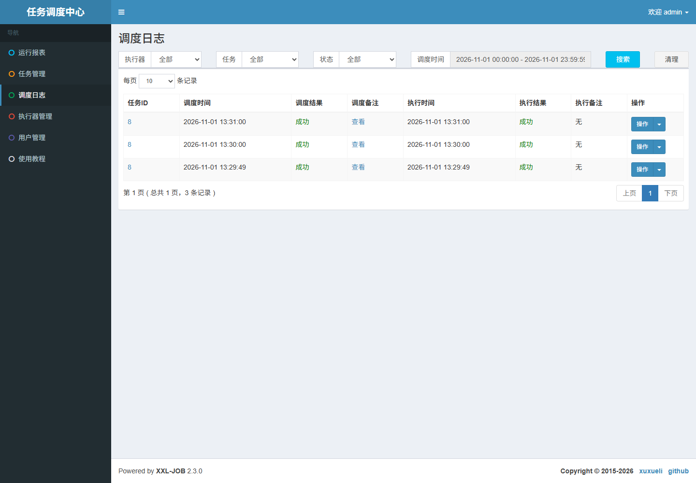

### 8.3 本次逐步验收记录

| 步骤 | 本次实际结果 | 范围说明 |
| --- | --- | --- |
| 乘客下单 | 成功，订单 ID `7` | 工单号 `2d9a5056a1fa4a39b766bbf9937d3e06` |
| 派单 | 成功，XXL-JOB 任务 ID `8` 自动 RUNNING | 已观察到司机大厅的真实消息 |
| 司机抢单 | 成功，司机 ID `1` | 管理详情接单时间 `2026-11-01 13:30:31` |
| 到达 | 成功调用，状态经过 3 | `arrive_time=2026-11-01 13:30:44`；位置由适配层设为起点 |
| 验车 | 成功写车辆信息，状态经过 4 | 车牌 `沪AD12345`，无真实验车照片 |
| 开始服务 | 成功，状态 5 | `start_service_time=2026-11-01 13:30:44` |
| 轨迹 | MongoDB 有 2 条订单7记录 | 起点约 `(31.221140,121.544090)`，终点约 `(31.222398,121.545040)`；不是持续 GPS 轨迹 |
| 结束计费 | 成功，状态 6 | `end_service_time=2026-11-01 13:30:54`，实际里程 `0.17km`，账单 `19.00元` |
| 分账计算 | 已生成分账记录 | 平台 `3.78`、司机 `13.60`、支付费用 `0.11`、税费 `1.51`，合计 `19.00`；不等于实际到账 |
| 支付与钱包 | 未验证 | 未发起微信支付，未证明钱包入账 |

本次浏览器操作之外，仅使用数据库只读查询交叉核对，没有改订单状态、补造派单消息或直接插入本次账单。需要技术同事复核时可执行以下只读命令；换一次验收应把 `7` 改为自己的订单 ID。

```powershell
docker exec roadrescue-mysql sh -c 'mysql -uroot -p"$MYSQL_ROOT_PASSWORD" -e "SELECT id,order_no,status,driver_id,arrive_time,start_service_time,end_service_time,real_distance,real_amount FROM daijia_order.order_info WHERE id=7; SELECT order_id,total_amount,pay_amount FROM daijia_order.order_bill WHERE order_id=7; SELECT order_id,platform_income,driver_income,status FROM daijia_order.order_profitsharing WHERE order_id=7;"'
docker exec roadrescue-mongo mongosh daijia --quiet --eval 'db.orderServiceLocation.find({orderId:7}).toArray()'
```

后端状态常用含义：1 等待接单、2 已接单、3 已到达、4 更新车辆、5 开始服务、6 结束服务、7 待付款、8 已付款、9 完成、-1 取消。两个 H5 会把多个后端状态合并显示，所以只看“已完成”不能判断已经付款。

## 9. 常见问题与已知缺口

### 9.1 常见问题排查

| 现象 | 先检查什么、怎么处理 |
| --- | --- |
| 页面无法访问 / Network Error | 检查对应 Vite 窗口是否仍运行，确认 9527/9090/9091 端口。页面能打开但接口失败，再查网关 8600 和 Nacos 注册；不要先改业务代码 |
| 页面显示旧状态 | 列表点“查询/刷新”；管理抽屉关掉重开，乘客返回重进；等请求完成再截图 |
| “登录已过期” | 关闭提示后重新走正常演示登录，再进入页面；不要遮掉提示伪造成功。改 real/mock 或清理 Redis 后旧 token 可能失效 |
| 真实接口全是本地数据 | 检查两端 `.env` 是否 `VITE_API_MODE=real`，重启开发服务器；看网络中是否有 `/customer-api`、`/driver-api` 请求 |
| 演示登录不可用 | 确认 Nacos 两个 web 配置启用了演示开关，导入演示用户，相关服务已重启并健康注册 |
| 地图搜索空白或定位不准 | 检查联网、地图 SDK/WebService Key、域名授权和配额；可取消搜索选择已返回的附近地点。默认定位不等于真实定位 |
| 下单失败 | 后端算路和 Drools 仍依赖地图/规则服务；检查 `TENCENT_MAP_KEY`、service-map、service-rules、XXL-JOB 定制接口，先确认详情或数据库里有没有已创建订单，避免重复提交 |
| 有新单但大厅空白 | 确认该订单任务 RUNNING、执行日志成功、执行器节点可达；司机已认证并开启服务且上报了附近位置；再查固定5公里搜索范围和1分钟队列过期问题 |
| 调大大厅半径没效果 | real 适配层未把全部筛选条件传给后端，后端搜索半径仍为5公里；当前界面筛选不代表后端能力 |
| 司机不能开始接单 | 检查认证、服务状态和当天人脸记录。测试数据只代替演示验证，不是真实人脸识别 |
| 确认发车/送达失败 | 不要反复点；重新打开详情看实际后端状态。发车是多次接口串联，可能部分成功；结束还依赖 MongoDB 轨迹、地图/规则服务 |
| Docker 显示 jar 是目录或无法挂载 | 检查第4.1节定制 jar 是否存在。不存在的 bind 文件可能被误建成目录；不能靠反复 up 解决缺失资产 |
| Java 启动失败 / 端口被占用 | 核对 JDK17、Maven 构建结果、Nacos和数据库健康、对应端口；先识别旧进程再停，不要杀全部 Java/Node 进程 |
| MySQL 中文乱码 | 使用 SQL 的 utf8mb4 设置与 UTF-8 客户端；PowerShell 输出问号可能只是终端编码，不要立即重新灌库 |

本次管理端在联调中途前端进程退出，浏览器出现不可访问页面；当时 Nacos、Java 服务、两个 H5 仍可用，未定位到进程退出根因。重新按第4.7节启动管理端（本次绑定127.0.0.1）后恢复，最终结算详情已重拍。下面保留真实失败现场，不能把它当成业务接口成功截图。

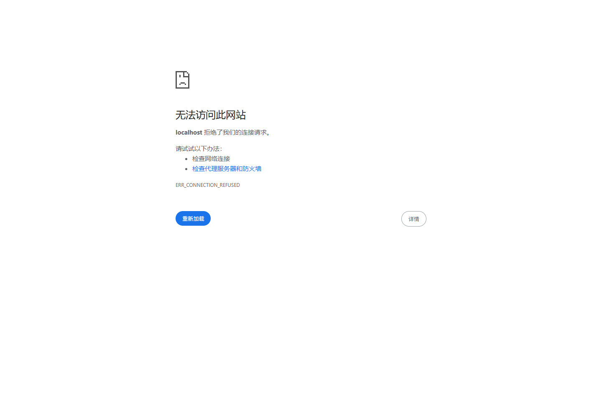

### 9.2 本次观察及代码确认的缺口

1. **冷启动资产缺失。** 仓库 Compose 引用的定制 XXL-JOB jar 不在约定目录，当前运行依赖临时目录副本；README 提到的 `xxl-job-master` 也不是本仓库目录。仓库外当前普通源码未查到上述定制接口，不能承诺按 README 编译即可补齐。
2. **价格口径不统一。** 本次乘客预估180元、司机大厅19元、司机详情180元、后端最终账单19元。救援价格存在 `remark.price`，后端仍按代驾 Drools 规则计费。派单数据未携带 `remark`，大厅服务分类和价格可能回退默认值。
3. **付款文案不准确。** 乘客把状态≥6映射为已完成，状态6时后端乘客详情尚不返回账单，适配层继续使用备注价格180元并显示“实付”；管理端 `realAmount` 列叫“实收”。这些都不能证明实际支付。司机“运费审核中”也是映射文案，不能证明已经存在可用的人工运费审核闭环。
4. **轨迹和验车是简化演示。** 发车先把位置设成起点，验车照片为空，送达前补报两点轨迹；本次实际0.17公里是两点计算结果，与道路导航预估0.88公里不同。未验证真实实时定位、道路轨迹回放和现场拍照。
5. **钱包和外部能力未形成完整实测闭环。** 微信登录/支付未接入H5，真实支付未测；人脸由当天预置记录替代。车辆、服务项目、兑换码，以及司机短信、分级认证、钱包流水仍有本地 Mock；“附近10辆、15分钟”和使用人数等展示不能当作实时统计。
6. **取消与调度能力不完整。** 乘客后端只允许待接单取消；司机“取消接单”没有真实后端实现，会提示联系调度改派。当前管理工单页没有完整改派操作，不能把提示当成已实现改派功能。
7. **大厅不是可靠的持久订单池。** 队列取走即消失，1分钟过期与15分钟去重可能造成漏看；页面的全国/距离等筛选未完整接入真实后端。演示司机50公里接单设置也不突破后端5公里GEO搜索。
8. **部分时间展示不完整。** 当前详情返回模型未提供全部接单、开始、结束字段，司机详情可能回退用创建时间显示“接单时间”，发车/送达时间不显示。精确时间以管理端详情、数据库为准。
9. **说明与环境仍有旧内容。** Compose只有六个中间件，不包含README目录描述中的MinIO；uni-app子目录README是旧模板。按本文核对，不要混用旧目录命令。

## 10. 停止服务与下次继续

本次手册制作结束后保留服务运行，方便继续查看截图对应数据。下面命令用于你需要停止时，**没有在本次验收结束时执行**。

1. 在三个前端各自终端按 `Ctrl+C`，如询问终止批处理则确认。后台启动的前端先定位本项目命令行和PID，再仅停止对应进程，不要停止所有Node程序。本次补启动的管理端输出在 `%TEMP%\roadrescue-manual-20261101\`。
2. 从根目录停止本项目后端：

```powershell
Set-Location 'D:\Projects\IDEAProjects\RoadRescue'
powershell -NoProfile -ExecutionPolicy Bypass -File .\backend\scripts\stop-all.ps1
```

该脚本先读 `backend/logs/pids.csv`，再按本项目 jar 路径清理 Java 残留。PID文件过旧时先核对进程，避免PID复用导致误停。当前服务可能由临时启动方式拉起，文件不存在时仍需核对脚本的路径匹配结果。

3. 最后停止中间件，保留数据卷：

```powershell
docker compose -f .\backend\infra\docker-compose.yml stop
docker compose -f .\backend\infra\docker-compose.yml ps -a
```

当前机器存在临时文件挂载，已有容器保留时可用同一 Compose 的 `start` 恢复；若要重新 `up`/重建，先解决第4.1节 jar及挂载路径问题。不要删除仍被运行容器依赖的临时文件。普通停机不需要 `down -v`。

下次继续时先恢复中间件、检查Nacos配置，再启动后端和前端，重新演示登录。跨日检查人脸演示数据；创建新的验收订单并记录新编号，避免把本文订单7的历史结果当作新一次测试。

## 11. 截图索引与复核方法

29张图片全部位于项目的 `docs/image/`，均已嵌入对应章节。编号不连续是因为剔除了重复和抽屉动画未结束的截图，文件名不是业务步骤编号。

| 类别 | 文件清单 |
| --- | --- |
| 管理端（9张） | `admin-01-login.png`、`admin-02-dashboard.png`、`admin-03-orders.png`、`admin-04-drivers.png`、`admin-05-passengers.png`、`admin-07-new-order.png`、`admin-09-unavailable.png`、`admin-10-finished-orders.png`、`admin-11-finished-detail.png` |
| 乘客端（9张） | `passenger-01-home.png`、`passenger-02-location-search.png`、`passenger-03-location-select.png`、`passenger-04-submit-form.png`、`passenger-05-waiting-detail.png`、`passenger-06-orders.png`、`passenger-07-rescuing-detail.png`、`passenger-08-finished-detail.png`、`passenger-09-history-orders.png` |
| 司机端（7张） | `driver-01-login.png`、`driver-02-hall-empty.png`、`driver-03-dispatched-hall.png`、`driver-04-grab-result.png`、`driver-05-service-started.png`、`driver-06-finished-detail.png`、`driver-07-my-orders.png` |
| XXL-JOB（4张） | `xxljob-01-tasks.png`、`xxljob-02-dispatch-running.png`、`xxljob-03-dispatch-stopped.png`、`xxljob-04-dispatch-log.png` |

本次使用独立 agent-browser 会话分别访问三端和XXL-JOB，管理端/任务页视口1440×1000，H5视口430×932，较长详情使用全页截图。复拍示例（先查看快照，再使用当前页面的实际引用，PowerShell中的 `@e1` 需加引号）：

```powershell
agent-browser skills get core
agent-browser --session roadrescue-review open http://localhost:9091
agent-browser --session roadrescue-review set viewport 430 932
agent-browser --session roadrescue-review snapshot
# 通过真实页面操作完成登录并等待内容加载，不修改DOM、接口响应或订单状态来制造画面
agent-browser --session roadrescue-review screenshot docs/image/复核-司机当前页面.png
agent-browser --session roadrescue-review close
```

复核代码入口：启动看 `backend/scripts/*.ps1`，服务端口/演示开关看 `DEFAULT_GROUP`，两端接口串联看 `apps/*/mock/real-adapter.js`，状态含义看后端 `OrderStatus.java`，派单队列行为看 `NewOrderServiceImpl.java`，页面字段看管理端 `src/views/Orders.vue`。本手册的启动说明来自这些源码与配置；冷启动缺失资产及未覆盖能力已明确列出，不代表本次重新搭建并验证了一个全新环境。
